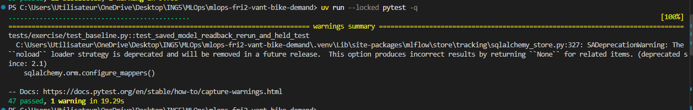
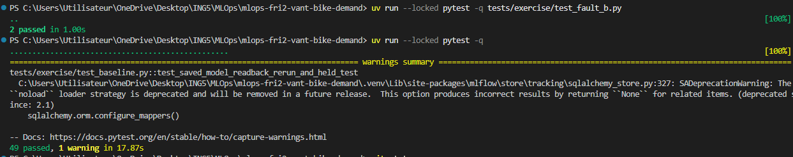

# Week 1 — 

# Lab 01 — Git Workflow & Code Quality

## Objective
Learn how to collaborate using GitHub, feature branches, Pull Requests, and automated code quality checks.

## Work Completed

- Worked on a dedicated Git branch in the team's shared repository.
- Fixed the `normalize_team_slug()` function in `src/bike_demand/team.py`.
- Replaced `.replace(" ", "-")` with `"-".join(team_name.lower().split())` to correctly handle multiple spaces, tabs, and newlines.
- Added a new unit test in `tests/lab1/test_team.py` to verify newline handling.
- Ran pytest and Ruff checks to validate the code.
- Created a Pull Request to merge the changes into `main`.
- The Pull Request was successfully merged.

## Tests

Commands used:

```bash
uv run --locked pytest -q -m lab1
uv run --locked pytest -q -m infra
uv run --locked ruff check .
uv run --locked ruff format --check .
```

**Result:** All Lab 1 tests and local quality checks passed.

## My Role — Evidence Recorder

My role was to document the work completed by the team, including code changes, test results, and the GitHub Pull Request workflow.

## Conclusion

Lab 1 helped me understand collaborative development with GitHub, automated testing, and the importance of code reviews before merging changes into the main branch.


# Lab 2: Bike Demand Baseline

## Objective

The goal of Lab 2 was to complete the provided bike-demand machine-learning baseline while respecting the dataset contract and preventing data leakage. I implemented the missing validation, chronological splitting, and model-training functions, then designed an independent fault-injection test. I worked in the team repository and prepared the changes for a pull request.

## My contribution

### 1. Data validation — `src/bike_demand/validate.py`

I implemented `check_domains()` to reject invalid input rather than silently repair it. The checks cover:

- Integer categorical values within their specified domains (including `hr` from 0 to 23).
- Finite normalized weather features (`temp`, `atemp`, `hum`, `windspeed`) within `[0, 1]`.
- Finite, nonnegative integer rental counts (`cnt`, `casual`, `registered`).
- Dates within the 2011–2012 window, with consistency checks for the `yr` and `mnth` fields.

The existing loader already checked required columns, missing values, numeric/date parsing, and unique positive `instant` identifiers; I kept that supplied behavior unchanged.

Validation command:

```powershell
uv run --locked python -m bike_demand.validate --data data/raw/hour.csv
```

**Observed result:** validation completed successfully on the supplied dataset. The original `data/raw/hour.csv` was not edited.

### 2. Chronological partitions — `src/bike_demand/split.py`

I implemented `split_data()` using the fixed date windows:

| Partition | Date window | Purpose |
| --- | --- | --- |
| Train | 2011-01-01 to 2011-12-31 | Fit models |
| Validation | 2012-01-01 to 2012-06-30 | Compare models using MAE |
| Test | 2012-07-01 to 2012-12-31 | Held out for later weeks |

Each partition is sorted by `(dteday, hr, instant)`. I added checks that every partition is nonempty, that identifiers do not overlap across partitions, and that all input rows are assigned.

**Decision:** I used chronological windows rather than a random split, so training only uses earlier observations and validation uses later observations. Missing hourly observations are not treated as invalid by themselves.

### 3. Baseline training — `src/bike_demand/train.py`

I completed three TODO functions:

- `select_features()` selects only the contract's 12 predictors in the prescribed order, excluding identifiers and target columns.
- `compare_mean()` computes the mean target on the training partition and evaluates that constant prediction on validation rows.
- `fit_evaluate()` fits `RandomForestRegressor` on 2011 training data and calculates predictions and MAE on January–June 2012 validation data only.

The model uses the supplied configuration: `n_estimators=50`, `max_depth=10`, `random_state=42`, and `n_jobs=1`. I left the supplied tracking, model persistence, metadata, and readback verification code intact.

Training command:

```powershell
uv run --locked python -m bike_demand.train --config configs/baseline.yaml
```

**Metrics:** Both models are evaluated using mean absolute error (MAE), expressed in rentals per hour, not classification accuracy. The Random Forest is not required to outperform the mean comparator. The actual observed metrics should be copied from the local training output or `reports/metrics.json` before submission:

| Validation metric | Observed value |
| --- | --- |
| Train-mean comparator MAE | **TODO: insert measured value** |
| Random Forest MAE | **TODO: insert measured value** |

No test-set metrics were computed.

### 4. Independent fault injection — Fault B

I created a small, controlled invalid-data example distinct from the supplied `missing-temp.csv` and `hum-out-of-range.csv` examples:

- `tests/fixtures/fault-b-control.csv`: three unchanged, valid rows copied from the raw dataset.
- `tests/fixtures/fault-b-invalid-hour.csv`: the same three rows, except one `hr` value is changed to `24`.
- `tests/exercise/test_fault_b.py`: one test confirms that the control loads successfully; a second confirms that the invalid hour raises `ValueError` mentioning `hr`.

This changes exactly one contract condition: the permitted hour range is 0–23. The original dataset remains unchanged.

Fault B verification:

```powershell
uv run --locked pytest -q tests/exercise/test_fault_b.py
```

## Tests, debugging, and evidence

I ran the exercise suite:

```powershell
uv run --locked pytest -q -m exercise
```

An intermediate run returned **34 passed, 1 failed, 12 deselected**. The remaining failure was `test_split_rejects_empty_partition`: my implementation correctly raised `ValueError` for an empty test partition, but the message said `partition must not be empty`, while the test expected the word `nonempty`.

I changed the error message to:

```python
raise ValueError(f"{name}: partition must be nonempty")
```

After that change, I reran the tests. **I confirmed that the complete test suite passed.** The intermediate run also showed a non-blocking MLflow/SQLAlchemy deprecation warning.

Full verification command:

```powershell
uv run --locked pytest -q
```

The two Fault B tests were added as additional coverage. **TODO:** add the final test count and/or a screenshot of the successful terminal output if required by the instructor.

## Version control and pull request

I prepared the following six source and test files for the Lab 2 PR:

```text
src/bike_demand/validate.py
src/bike_demand/split.py
src/bike_demand/train.py
tests/exercise/test_fault_b.py
tests/fixtures/fault-b-control.csv
tests/fixtures/fault-b-invalid-hour.csv
```

I deliberately excluded the unrelated untracked `mlops-course/` directory and generated `reports/metrics.json` / `reports/metrics-history.jsonl` from the proposed code commit. The intended workflow is to commit on a dedicated feature branch, push that branch, and open a PR targeting `main` rather than pushing directly to `main`.

- **Branch:** TODO — insert actual branch name
- **PR link:** TODO — insert GitHub PR URL
- **Commit hash:** TODO — insert commit hash
- **Review feedback / response:** TODO — complete after review

## Blockers and assistance

The main blocker was the failing assertion for the empty-partition error message. The check's logic was correct, but the test contract required a specific keyword. I inspected the failure output, updated the message, and reran the suite successfully.

I used ChatGPT for implementation guidance, interpreting the test failure, and designing the Fault B fixture and test. I reviewed and executed the changes locally. The resulting behavior was checked with the provided pytest suite.

## Reflection

This lab showed why an MLOps baseline needs more than a model that trains: input contracts, deterministic chronological splits, explicit evaluation boundaries, and reproducible test evidence all matter. In particular, I learned to keep the future test period untouched, compare models on identical validation rows, and create a deliberate invalid fixture paired with a valid control. The test failure also showed that automated checks can enforce both functional behavior and error-message contracts.

## Remaining actions

- [ ] Insert measured validation MAEs from the local run.
- [ ] Add the final test count or screenshot if requested.
- [ ] Add branch, commit, and PR references after opening the PR.
- [ ] Record reviewer comments and how I responded.


Annex :
Validation of the global test after all the modification :

Add of the two test exercise : 
